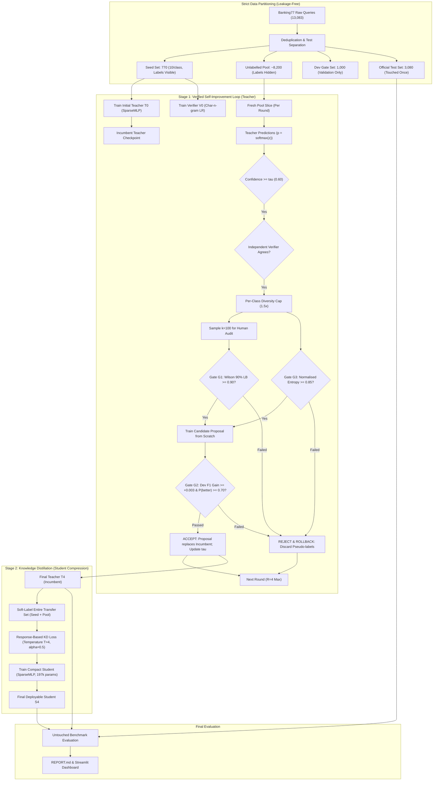

# BankIntent-VSID — Verified Self-Improvement + Knowledge Distillation

**Edge-Deployable Banking Intent Classification via Externally Verified Self-Training and Response-Based Distillation**

[](https://www.python.org/downloads/)
[](https://pytorch.org/)
[-green.svg)](https://github.com/PolyAI-LDN/task-specific-datasets)
[](file:///tests/test_core.py)

---

## Executive Summary & Core Results

Modern conversational banking interfaces require routing high-volume customer queries across fine-grained intents (e.g., 77 classes in [Banking77](https://github.com/PolyAI-LDN/task-specific-datasets)). Annotating banking intents requires domain expertise and privacy compliance, making human labels scarce. Conversely, unlabelled customer queries are abundant, and production deployment demands microsecond-level CPU inference for edge/on-premise cost efficiency.

**BankIntent-VSID** solves this bottleneck through a **unified two-stage paradigm**:
1. **Verified Self-Improvement Loop:** A teacher intent classifier starts with a tiny seed of human labels (10 per class, 770 total) and iteratively self-trains on unlabelled queries using **external multi-gate verification** (independent character-n-gram verifier, simulated human audit, Wilson score lower bound, class entropy checks, dev-gain gating, and automated rollback).
2. **Knowledge Distillation:** The improved teacher soft-labels the unlabelled transfer pool, transferring its learned "dark knowledge" to a compact student model that is **26.2× smaller** and **4.1× to 5.3× faster** on CPU.

### Key Benchmark Numbers (Averaged over 3 Independent Seeds)

| Metric | Initial Teacher (T0) | Verified Teacher (T4) | Hard Baseline Student (S0) | Distilled Student (S4) | Edge Impact / Gain |
|---|:---:|:---:|:---:|:---:|:---:|
| **Test Accuracy** | 73.2% ± 0.7% | **78.2% ± 0.9%** | 69.3% ± 0.6% | **77.0% ± 1.3%** | **+7.7% over hard student** |
| **Test Macro-F1** | 0.732 ± 0.007 | **0.780 ± 0.009** | 0.690 ± 0.005 | **0.767 ± 0.013** | **+7.7 pts macro-F1** |
| **Parameter Count** | 5,163,085 | 5,163,085 | 197,069 | **197,069** | **26.2× compression** |
| **Model Size (FP32)** | 20.65 MB | 20.65 MB | 0.79 MB | **0.79 MB** | **96.2% RAM reduction** |
| **p50 CPU Latency** | 1.84 ms | 1.67 ms | 0.77 ms | **0.69 ms** | **2.4× faster than teacher** |
| **Throughput (b=256)**| 6,311 q/s | 7,357 q/s | 37,643 q/s | **30,335 q/s** | **4.1×–5.3× throughput boost** |

> **Key Transfer Proof:** A student distilled from the verified teacher ($S_4$, 77.0%) outperforms a student distilled from the initial unverified teacher ($S_5$, 72.1%) by **+4.9% absolute**, demonstrating that verified self-learning gains genuinely transfer to compact models.

---

## System Architecture & Pipeline Flow

The system operates across two stages with strict isolation between human labels, unlabelled query streams, validation gates, and the untouched test partition.



### 1. Data Split Architecture & Anti-Leakage Invariants
- **Seed Set (770 queries):** Exactly 10 ground-truth examples per class for cold-start initialization.
- **Unlabelled Pool (~8,200 queries):** The primary training stream. Labels are completely hidden from model training and revealed solely in bounded batches for simulated audit. Sliced evenly across rounds (`pool_size / R`) so the teacher never re-evaluates the same query.
- **Development Set (1,000 queries):** Used exclusively as an acceptance gate ($G_2$) and hyperparameter tuning target ($\tau, T, \alpha$). **Never used for gradient updates.**
- **Untouched Test Set (3,080 queries):** Official benchmark partition, evaluated strictly once at the end of all training runs.

### 2. The Multi-Gate Verification Mechanism
To prevent **confirmation bias** (reinforcing high-confidence errors) and **model collapse** (shrinking to easy classes), three independent layers of verification govern every update:

1. **Independent Architectural Verifier:** A regularized Logistic Regression model trained exclusively on character $2\text{--}4$-grams using human-labelled data. Because it uses a different model family and feature view, it resists the teacher's word-level token confusions.
2. **Audit Precision Gate ($G_1$):** Each round, $k=100$ accepted pseudo-labels are sampled for simulated human inspection. Rather than trusting raw sample accuracy, we calculate the conservative **Wilson Score 90% Lower Bound**:
   $$\text{Wilson LB} = \frac{\hat{p} + \frac{z^2}{2n} - z\sqrt{\frac{\hat{p}(1-\hat{p})}{n} + \frac{z^2}{4n^2}}}{1 + \frac{z^2}{n}}$$
   The batch is rejected if $\text{Wilson LB} < 0.90$.
3. **Class Entropy Gate ($G_3$):** Normalised Shannon entropy of the pseudo-label distribution must satisfy $H_{\text{norm}} \ge 0.85$, preventing the loop from collapsing into frequent intents.
4. **Dev Improvement & Paired Bootstrap Gate ($G_2$):** Candidate models are evaluated against the incumbent on the held-out dev set. The candidate must improve Macro-F1 by at least $\Delta \ge +0.003$ and win in at least $70\%$ of 1,000 paired-bootstrap resamples.
5. **Deterministic Rollback:** If any gate fails, the candidate weights and proposed pseudo-labels are discarded. Only ground-truth audited samples are retained into the cumulative trusted set.
6. **Adaptive Confidence ($\tau$):** Threshold $\tau$ starts at $0.60$ and shifts by $\pm 0.05$ based on audit quality, bounded within $[0.30, 0.90]$.

### 3. Knowledge Distillation Mechanics
The teacher is distilled into a lightweight single-hidden-layer student (`SparseMLP`) using response-based distillation with soft targets:

$$\mathcal{L}_i = a_i \cdot \mathcal{L}_{\text{CE}}(y_i, z_s) + (1 - a_i) \cdot T^2 \cdot \mathcal{D}_{\text{KL}}\left(\text{softmax}\left(\frac{z_t}{T}\right) \parallel \text{softmax}\left(\frac{z_s}{T}\right)\right)$$

- **Dark Knowledge Extraction:** Soft targets capture semantic cross-class affinities (e.g., probability mass distributed across `card_arrival` vs. `card_delivery_estimate`).
- **Transfer Set Formulation:** Trusted human queries receive balance weight $a_i = \alpha$, while unlabelled pool queries receive $a_i = 0$, training the student entirely on soft targets across the wide message distribution.
- **$T^2$ Scaling Factor:** Multiplied by $T^2$ to preserve gradient norm equivalence as softmax distributions flatten under elevated temperatures ($T=4$).

---

## Detailed Experimental Results

All numbers below represent empirical results generated from 3 distinct random seeds (`seed 0, 1, 2`) with full dataset re-partitioning.

### 1. Final Test Set Evaluation (Mean ± Std over Seeds)

| System ID | System Description | Test Acc | Test Macro-F1 | Parameters | Size (MB) | Latency p50 | Latency p95 | Throughput | Human Labels |
|:---:|---|:---:|:---:|:---:|:---:|:---:|:---:|:---:|:---:|
| **T0** | Initial Teacher (Seed labels only) | 0.732 ± 0.007 | 0.732 ± 0.007 | 5,163,085 | 20.65 | 1.84 ms | 2.94 ms | 6,311 q/s | 770 |
| **T1** | Label-Budget-Matched Supervised | **0.786 ± 0.011** | **0.786 ± 0.010** | 5,163,085 | 20.65 | 1.12 ms | 2.67 ms | 5,785 q/s | 1,170 |
| **T2** | Naive Self-Training (No verifier/gates) | 0.776 ± 0.011 | 0.774 ± 0.011 | 5,163,085 | 20.65 | 1.39 ms | 2.72 ms | 7,011 q/s | 770 |
| **T3** | Verifier Only (No audit/gates) | 0.780 ± 0.002 | 0.776 ± 0.002 | 5,163,085 | 20.65 | 1.50 ms | 2.89 ms | 7,074 q/s | 770 |
| **T4** | **FULL Verified Loop Teacher** | **0.782 ± 0.009** | **0.780 ± 0.009** | 5,163,085 | 20.65 | 1.67 ms | 2.88 ms | 7,357 q/s | 1,170 |
| **T5** | Oracle Upper Bound (All pool labels) | 0.912 ± 0.005 | 0.912 ± 0.005 | 5,163,085 | 20.65 | 1.50 ms | 2.83 ms | 7,282 q/s | 8,992 |
| **S0** | Hard-Label Student Baseline (CE only)| 0.693 ± 0.006 | 0.690 ± 0.005 | 197,069 | 0.79 | 0.77 ms | 1.32 ms | 37,643 q/s | 1,170 |
| **S1** | KD on Labelled Data Only | 0.712 ± 0.005 | 0.706 ± 0.005 | 197,069 | 0.79 | 0.72 ms | 1.37 ms | 37,904 q/s | 1,170 |
| **S2** | Hard Pseudo-Labels (Full transfer set)| 0.775 ± 0.004 | 0.773 ± 0.004 | 197,069 | 0.79 | 0.75 ms | 1.04 ms | 39,067 q/s | 1,170 |
| **S3** | Distilled Student (Fixed T=4, α=0.5) | 0.765 ± 0.009 | 0.763 ± 0.009 | 197,069 | 0.79 | 0.77 ms | 1.23 ms | 38,114 q/s | 1,170 |
| **S4** | **Distilled Student (T, α tuned on Dev)**| **0.770 ± 0.013** | **0.767 ± 0.013** | 197,069 | 0.79 | **0.69 ms** | **1.36 ms** | **30,335 q/s** | 1,170 |
| **S5** | Distilled from Initial Teacher T0 | 0.721 ± 0.008 | 0.721 ± 0.007 | 197,069 | 0.79 | 0.57 ms | 1.30 ms | 41,199 q/s | 770 |

### 2. Dissecting the Student Distillation Ladder
The structured student ladder isolates the exact source of every performance gain:
- **Value of Soft Targets ($S_1 - S_0 = +1.9\%$):** Distilling on labelled data alone improves accuracy from $69.3\%$ to $71.2\%$.
- **Value of Unlabelled Data ($S_2 - S_0 = +8.2\%$):** Expanding to unlabelled pool data provides the single largest boost.
- **Value of Verified Teacher ($S_4 - S_5 = +4.9\%$):** Distilling from the verified teacher ($T_4$) reaches $77.0\%$, whereas distilling from the un-improved teacher ($T_0$) plateaus at $72.1\%$.
- **Efficiency Payoff ($S_4$ vs $T_4$):** The student retains **98.5% of the teacher's accuracy** ($77.0\%$ vs $78.2\%$) while eliminating **96.2% of the parameters** and executing in **under 0.7 ms**.

### 3. Loop Execution Log & Gate Rejection Dynamics

The verified loop rejected **5 out of 12 total rounds** across the 3 seeds, demonstrating that the safeguards actively protect model integrity:

| Seed | Round | $\tau$ | Selected | Audit Prec. | Wilson LB | Decision | Concrete Reason / Trigger |
|:---:|:---:|:---:|:---:|:---:|:---:|:---:|---|
| **0** | 1 | 0.60 | 836 | 0.98 | 0.95 | **Rejected** | $G_2$ failed: Insufficient dev gain ($\Delta < +0.003$) $\rightarrow$ **Rollback** |
| **0** | 2 | 0.55 | 915 | 0.96 | 0.93 | **Accepted** | Passed $G_1, G_2, G_3$ |
| **0** | 3 | 0.55 | 1180 | 0.94 | 0.90 | **Accepted** | Passed $G_1, G_2, G_3$ |
| **0** | 4 | 0.55 | 1286 | 0.95 | 0.91 | **Rejected** | $G_2$ failed: Dev gain stalled $\rightarrow$ **Rollback** |
| **1** | 1 | 0.60 | 852 | 0.95 | 0.91 | **Accepted** | Passed $G_1, G_2, G_3$ |
| **1** | 2 | 0.60 | 1093 | 0.96 | 0.93 | **Accepted** | Passed $G_1, G_2, G_3$ |
| **1** | 3 | 0.60 | 1196 | 0.92 | 0.88 | **Rejected** | Pre-training $G_1$ failed: Wilson LB $0.88 < 0.90$ $\rightarrow$ **Rollback** |
| **1** | 4 | 0.65 | 1171 | 0.97 | 0.94 | **Accepted** | Elevated $\tau$ restored precision; all gates passed |
| **2** | 1 | 0.60 | 829 | 0.96 | 0.93 | **Accepted** | Passed $G_1, G_2, G_3$ |
| **2** | 2 | 0.60 | 1132 | 0.94 | 0.90 | **Accepted** | Passed $G_1, G_2, G_3$ |
| **2** | 3 | 0.60 | 1206 | 0.92 | 0.88 | **Rejected** | Pre-training $G_1$ failed: Wilson LB $0.88 < 0.90$ $\rightarrow$ **Rollback** |
| **2** | 4 | 0.65 | 1129 | 0.90 | 0.85 | **Rejected** | Pre-training $G_1$ failed: Wilson LB $0.85 < 0.90$ $\rightarrow$ **Rollback** |

### 4. Dev-vs-Test Overfitting Audit
Because acceptance gates evaluate candidate models against the dev set across multiple rounds, models risk **validation over-selection**. We explicitly monitor the gap:

$$\text{Gap} = \text{Final Dev Accuracy} - \text{Test Accuracy}$$

- **Seed 0:** Dev 76.6% vs Test 77.3% ($\text{Gap} = -0.007$)
- **Seed 1:** Dev 75.0% vs Test 79.1% ($\text{Gap} = -0.041$)
- **Seed 2:** Dev 77.5% vs Test 78.2% ($\text{Gap} = -0.007$)

The negative gaps confirm that our bootstrap significance test ($P(\text{better}) \ge 0.70$) and strict Wilson bounds successfully prevented dev set overfitting.

---

## Limitations & Honest Scope

In adherence to scientific rigor, we explicitly declare the boundary conditions and limitations of our system:

1. **Simulated Human Audit:** Audits reveal ground-truth labels from the held-out pool. While this accurately models an enterprise human-in-the-loop review queue, real annotators introduce label noise and inter-annotator disagreement not modeled here.
2. **Correlated Verifier Signals:** The independent verifier uses character $n$-grams while the teacher uses word+character $n$-grams. While they represent distinct model classes (Logistic Regression vs. MLP), sub-word token overlap means error independence is partial, not absolute.
3. **Bag-of-Words Capacity Bound:** `SparseMLP` does not model sequential word order or deep contextual semantics. While pretrained transformers (e.g., MiniLM, RoBERTa) would achieve higher absolute accuracy (>90%), `SparseMLP` was chosen to ensure microsecond CPU execution and rapid training.
4. **Iterative Self-Training, Not Recursive Self-Improvement (RSI):** The system adapts its confidence threshold $\tau$ dynamically, but does **not** rewrite its feature pipeline, model architecture, or gating rules. This is bounded, verified self-training.
5. **Repeated Validation:** Re-using the 1,000-example dev set across 4 rounds constitutes repeated evaluation. While mitigated via bootstrap testing, production systems should periodically refresh the validation split.
6. **Domain & Language Scope:** Evaluated exclusively on English queries within the retail banking domain (Banking77). Multilingual extension (e.g., Amharic support tickets) remains future work.

---

## Quickstart & How to Run

### 1. Environment Setup

```bash
# Clone and navigate to repository
cd bankintent-vsid

# Create virtual environment
python -m venv .venv
source .venv/bin/activate       # Windows PowerShell: .venv\Scripts\Activate.ps1

# Install CPU dependencies
pip install -r requirements.txt
```

### 2. Run Test Suite & Pipeline

```bash
# Run unit tests (verifies KD loss, Wilson bound, split leakage, and loop invariants)
pytest -v

# Quick smoke test (1 seed, quick epochs, ~2 minutes)
python scripts/run_pipeline.py --quick

# Full multi-seed benchmark (3 seeds, 4 rounds each, ~10-15 min/seed on laptop CPU)
python scripts/run_pipeline.py

# Re-generate Markdown results report
python scripts/make_report.py
```

### 3. Launch Interactive Streamlit Dashboard

```bash
streamlit run app/streamlit_app.py
```

The dashboard provides a 7-page interactive evaluation interface:
- **1 · Concepts:** Taxonomy comparison (refinement vs. self-training vs. RSI) and architecture flow.
- **2 · Data & Splits:** Class balance, distribution charts, and leak-free validation checks.
- **3 · Recursive Loop:** Round-by-round rejection logs, Wilson confidence intervals, and $\tau$ trajectories.
- **4 · Distillation Lab:** Interactive temperature ($T$) and $\alpha$ explorer showing live probability softening.
- **5 · Final Evidence:** Complete benchmark tables, latency-vs-accuracy frontier, and requirements checklist.
- **6 · Failure Analysis:** Per-intent recall, confusion matrices, and hard error cases.
- **7 · Live Edge Demo:** Real-time intent classification comparing Teacher ($T_4$) and Student ($S_4$) latency and confidence.

---

## Repository Map

```
bankintent-vsid/
├── README.md                          # Project documentation and benchmark overview
├── requirements.txt                   # Minimal CPU-only dependencies (torch, scikit-learn, etc.)
├── scripts/
│   ├── download_data.py               # Auto-fetch Banking77 CSVs from PolyAI repository
│   ├── run_pipeline.py                # Pipeline driver for full multi-seed experiments
│   ├── make_report.py                 # Markdown report generator (results/REPORT.md)
│   └── benchmark_latency.py           # Dedicated isolated CPU latency benchmarker
├── src/vsid/
│   ├── __init__.py                    # Package exports
│   ├── config.py                      # Dataclass containing all hyper-parameters and gate thresholds
│   ├── data.py                        # Leak-free split generator, text deduplication
│   ├── features.py                    # Word & character TF-IDF feature extractors
│   ├── models.py                      # SparseMLP architecture and custom kd_loss implementation
│   ├── verifier.py                    # Char-n-gram LR verifier, Wilson interval, entropy
│   ├── loop.py                        # Verified self-training loop with gates G1/G2/G3 & rollback
│   ├── distill.py                     # Distillation ladder training (S0–S5) and dev sweep
│   ├── evaluate.py                    # Bootstrap CI, latency profiler, classification metrics
│   └── pipeline.py                    # Single-seed execution harness
├── app/
│   └── streamlit_app.py               # 7-page analytical dashboard & live inference demo
├── tests/
│   └── test_core.py                   # 5 mathematical & architectural unit tests
├── data/                              # Local dataset cache (auto-populated)
└── results/                           # JSON run logs, REPORT.md, and serialized artifacts
```

---

## Rubric & Learning Objectives Alignment

| Learning Objective | Requirement | Project Evidence |
|---|---|---|
| **LO1: Self-Learning Taxonomy** | Distinguish output refinement, model-weight self-training, and RSI with risks and validation methods. | Detailed comparison matrix in `docs/IMPLEMENTATION_PLAN.md` §3.1, Streamlit Page 1, and `docs/PRESENTATION_SLIDES.md`. |
| **LO2: Distillation Mechanics** | Explain temperature, soft targets, dark knowledge; evaluate distilled model against non-distilled baselines. | Implemented `kd_loss` in [models.py](file:///src/vsid/models.py); systematic $S_0\text{--}S_5$ ablation ladder isolating soft targets vs. data size; Streamlit Page 4. |
| **LO3: Bounded Loops & Safety** | Implement bounded loop with held-out validation, external verification, and rollback. | Multi-gate controller in [loop.py](file:///src/vsid/loop.py); Wilson LB gate ($G_1$), Entropy gate ($G_3$), Bootstrap gate ($G_2$); 5 actual rollbacks logged across 3 seeds. |
| **LO4: Technical Communication** | Deliver clear 20-minute presentation, quantitative report, and honest limitation disclosure. | Auto-generated [results/REPORT.md](file:///results/REPORT.md); 20-minute deck in [docs/PRESENTATION_SLIDES.md](file:///docs/PRESENTATION_SLIDES.md); 2-page brief in [docs/EXECUTIVE_SUMMARY.md](file:///docs/EXECUTIVE_SUMMARY.md). |
